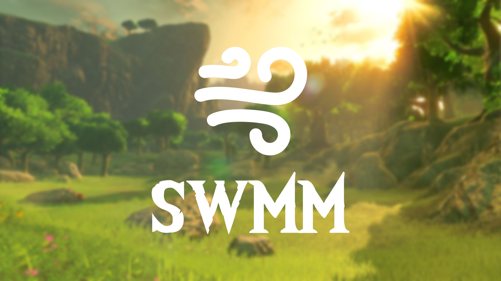

  

<h3 align="center">The mod manager for Savage Wind</h3>

  Install, merge and play <i>The Legend of Zelda: Breath of the Wild</i> mods on
  <a href="https://github.com/Revivedx/SavageWindRecomp">Savage Wind</a>.

  
  
  

  <a href="../../releases/latest"><b>Download the latest release</b></a>

---

## Features

### Install and play

- **Install anything.** Drop a mod file or folder onto the window: UKMM packages, BNPs, archives and loose folders all work.
- **Browse GameBanana** for Switch or Wii U mods and install them without leaving the app.
- **Wii U mods work too.** They're converted for Switch when you add them. See [Wii U mods](#wii-u-mods) below.
- **One click to play.** SWMM finds Savage Wind for you and never touches your game files.
- **Cheats.** Infinite hearts, stamina, arrows and rupees, durability and weather, on
  the Cheats page. They're Savage Wind's own cheats, so they work on game versions 1.8.2 and 1.9.0, and they change
  while you play. With a save loaded you can also set the time, fly and teleport by clicking a map.

### Use many mods together

- **Smart merging.** Mods that change the same things are combined instead of overwriting each other. When two mods
  change the very same thing, the one lower in the list wins.
- **Only real changes.** Anything a mod copies unchanged from the game is dropped when it's installed, so it can't undo
  another mod's changes.
- **See what overrides what.** Select a mod to see which mods share its files and which one wins, then move it with one
  click.
- **Profiles** for different setups, each with its own load order.
- **Modpacks.** Share a profile, with its mods, order and options, as one `.swmmpack` file. Opening one installs
  everything as a new profile.

### Stay safe

- **Crash helper.** If Savage Wind closes with an error, SWMM lists the mods linked to it and can turn them off.
- **Save backups.** Your saves are backed up before each start, and you can restore any backup from Settings.

### Made for every screen

- **Fits small screens** such as the Steam Deck in Game Mode.
- **Dark and light themes** in 10 languages.

## Wii U mods

SWMM converts Wii U mods for Switch as you install them, so mods that were never ported can still be used.

| Converted | Details |
| --- | --- |
| Models and textures | Every model, texture and animation type the game uses |
| Menus and fonts | UI layouts, their animations and textures, and fonts |
| Sound and music | Music streams and sound archives |
| Game data | Actors, maps, events, texts, terrain and collision |
| Effects | A mod's effect edits are carried onto the Switch game's effects |
| Packages | UKMM packages and BNPs made for Wii U |

**Not converted:** shaders and edits inside compiled effect shaders, because they're GPU programs built for the Wii U.
Anything left out is listed in the log, and files a mod copies unchanged from the game are swapped for the Switch
version's own.

**How well it works:** the converter was checked against the whole Wii U game. More than 150,000 files come out byte for
byte the same as the Switch version, and the rest differ only where Nintendo changed the game for Switch. Of the 45 most
downloaded Wii U mods on GameBanana, 39 convert fully and 6 partly. The **Compatibility** page in the app lists them,
and you can test any mod file there without installing it.

## Getting started

1. Install SWMM from the latest [release](../../releases/latest) with the one-line install command, the `.msi`
   installer or the portable `.zip`.
2. Open it. SWMM finds Savage Wind automatically, or you can choose it in **Settings**.
3. Add mods by dragging them onto the window, or from the **Browse** page.
4. Press **Play**.

Mods load however you start Savage Wind: through a small loader on Windows, and through Savage Wind's own launch
options on Linux and Steam Deck, so Steam shortcuts and Game Mode work too.

## Not supported

SWMM only installs mods made of game files. Code patches (ExeFS, `.ips`, `.pchtxt`), code plugins (exlaunch, skyline)
and cheat code files (Atmosphère `.txt`) aren't installed; use the Cheats page instead. A mod that has both gets its game files installed.

## Building

Install [Rust](https://rustup.rs), then run `cargo build --release --workspace`. The app is placed in `target/release`
as `swmm` (`swmm.exe` on Windows). On Windows, keep `swmm_loader.dll` next to it, renamed to `swmm.dll`.

## License and credits

SWMM is free software under the [GNU General Public License v3.0](LICENSE).

- Built on [U-King Mod Manager](https://github.com/NiceneNerd/ukmm) by Caleb Smith and Ginger Chody. SWMM uses UKMM's
  `uk-content`, `uk-mod`, `uk-reader` and `uk-util` crates from the
  [`swmm` branch of a UKMM fork](https://github.com/ustruct/ukmm/tree/swmm), which adds a few fixes SWMM needs.
- Havok classes ported from botw_havok and HKX2.
- Icons from [Font Awesome Free](https://fontawesome.com). Title font *The Wild Breath of Zelda* by Chequered Ink.

SWMM is a fan project and isn't affiliated with Nintendo.
