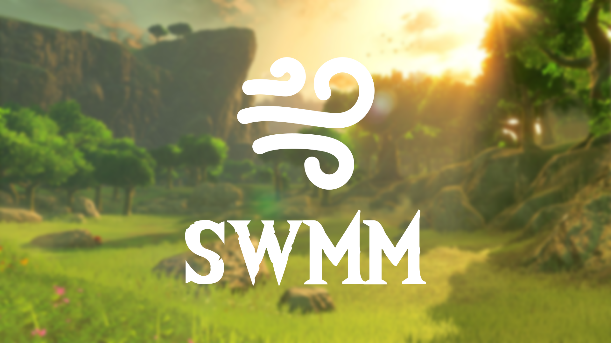

  

<h3 align="center">The mod manager for Savage Wind</h3>

  Install, merge and play <i>The Legend of Zelda: Breath of the Wild</i> mods on
  <a href="https://github.com/Revivedx/SavageWindRecomp">Savage Wind</a>.

  
  
  

---

## Features

- **Install anything.** Drop in a mod file or folder and SWMM takes care of the rest.
- **Browse GameBanana** and install mods without leaving the app.
- **Use many mods together.** Mods that change the same things are combined instead of overwriting each other.
- **Profiles** for different mod setups, with your own load order.
- **Works on its own.** SWMM finds Savage Wind for you and never touches your game files.
- **Dark and light themes** in 10 languages.

## Getting started

1. Install SWMM from the latest [release](../../releases/latest): run the one-line install command, use the `.msi` installer, or download the `.zip`.
2. Open it. SWMM finds Savage Wind automatically, or you can pick it in **Settings**.
3. Add mods by dragging them onto the window or from the **Browse** page.
4. Press **Play**.

## Building

Install [Rust](https://rustup.rs), then run `build-windows.bat` on Windows or `build.sh` on Linux. The finished
app is placed in the `dist` folder.

## License and credits

SWMM is free software under the [GNU General Public License v3.0](LICENSE).

Built on [U-King Mod Manager](https://github.com/NiceneNerd/ukmm) by Caleb Smith and Ginger Chody. SWMM uses UKMM's
`uk-content`, `uk-mod`, `uk-reader` and `uk-util` crates directly, from the
[`swmm` branch of a UKMM fork](https://github.com/ustruct/ukmm/tree/swmm), which adds a few fixes SWMM needs. Icons
from
[Font Awesome Free](https://fontawesome.com). Title font *The Wild Breath of Zelda* by Chequered Ink.

SWMM is a fan project and isn't affiliated with Nintendo.
